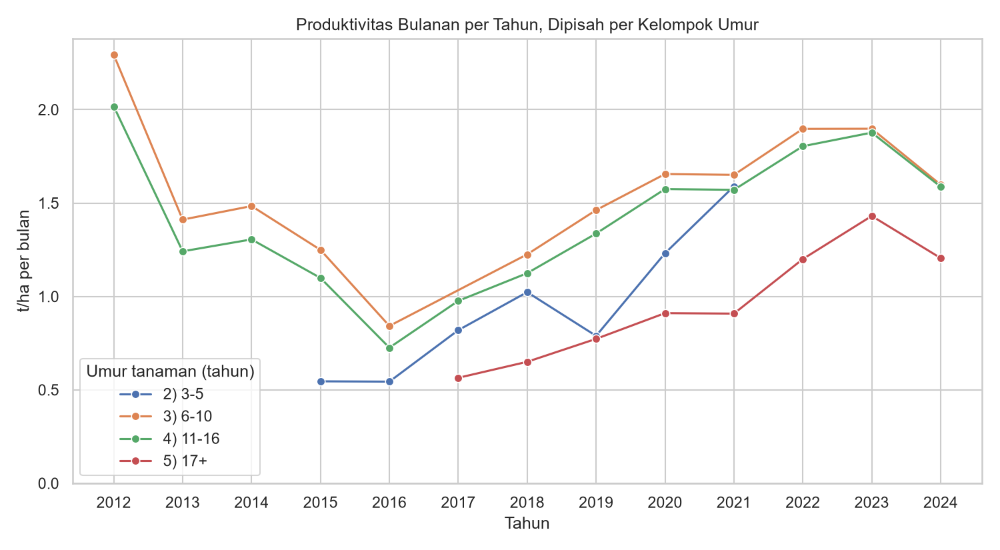
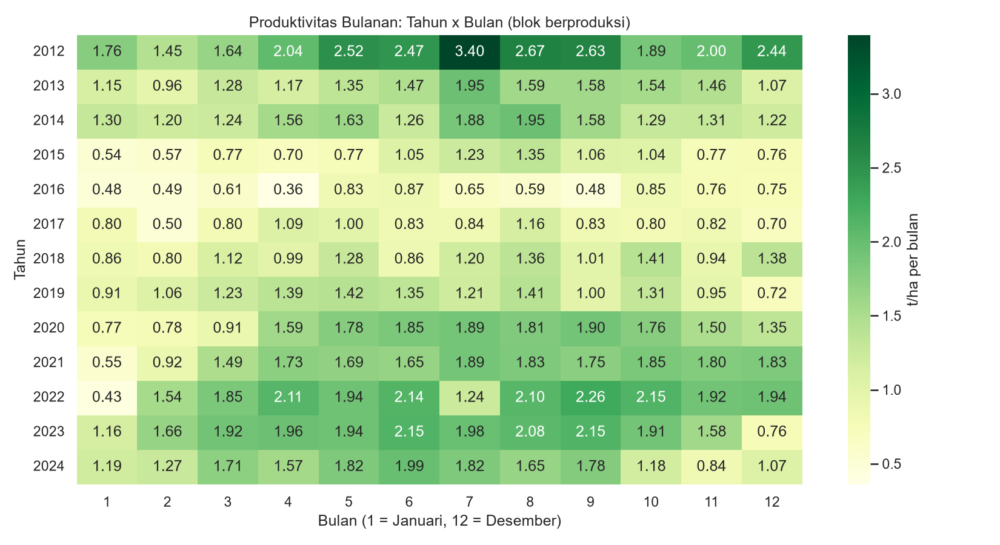
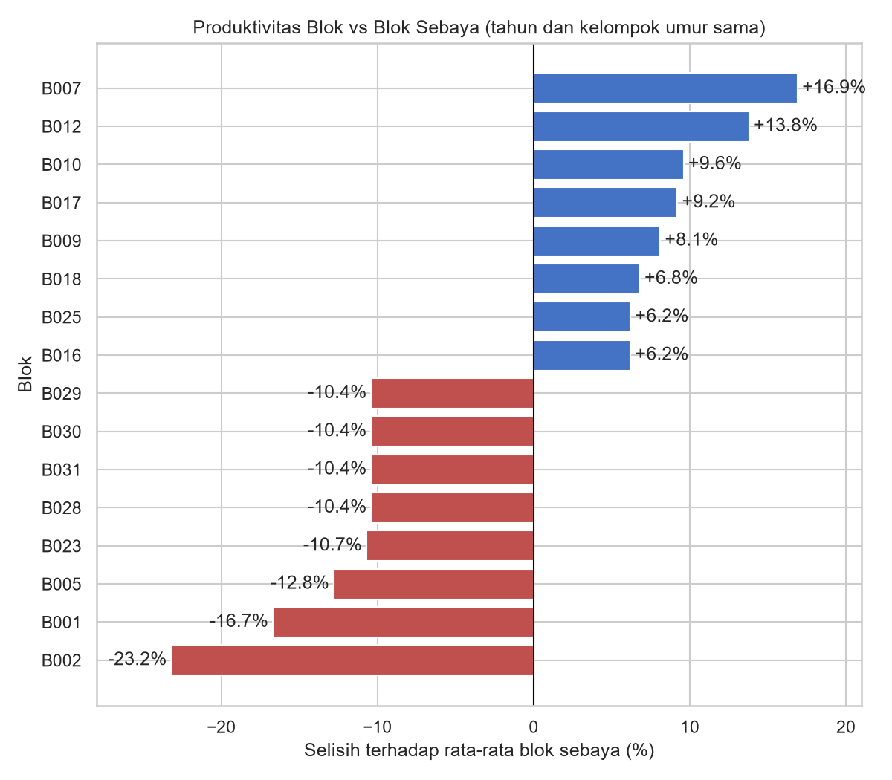

# Analisis Produktivitas Kebun Kelapa Sawit (2012-2024)

Analisis end-to-end data produktivitas bulanan 42 blok kebun kelapa sawit di Indonesia, dari data mentah sampai insight dan dashboard. Dikerjakan dengan **Excel** (Power Query, PivotTable, Slicer) dan **Python** (pandas, matplotlib, seaborn).


## Pertanyaan yang Dijawab

1. Bagaimana tren produktivitas kebun dari tahun ke tahun?
2. Pada umur berapa tanaman paling produktif, dan kapan mulai menurun?
3. Apakah ada pola musiman dalam setahun?
4. Apakah jenis bibit memengaruhi produktivitas?
5. Blok mana yang benar-benar unggul atau tertinggal, setelah memperhitungkan umur dan tahun?

## Dataset

- **Sumber:** *Long-Term Block-Level Oil Palm Productivity Dataset with Leaf Nutrient and Soil Fertility Measurements from an Indonesian Plantation* (Mendeley Data, versi 2): https://data.mendeley.com/datasets/93k3733p6x/2
- **Tabel yang dipakai:** `productivity_monthly.csv` (6.552 baris, 15 kolom: 42 blok x 156 bulan, 2012-2024).
- **Tabel yang belum dipakai:** data daun dan tanah (`leaf_sampling_event`, `soil_sampling_event`, beserta tabel penghubungnya). Lihat bagian "Pengembangan Lanjutan".
- Data tidak disertakan di repo ini. Unduh dari tautan di atas (periksa lisensi dan ketentuan sitasi di halaman dataset), lalu taruh di folder `data/`.
- Kode di repo ini berlisensi MIT. Dataset mengikuti lisensi sumbernya di Mendeley Data

## Metode

**Pembersihan dan validasi**
- Tidak ada nilai kosong dan tidak ada baris duplikat (6.552 baris, 42 blok unik).
- 1.800 baris berstatus **TBM** (tanaman belum menghasilkan) dengan produksi 0. Baris ini dikeluarkan dari semua perhitungan rata-rata produktivitas, karena jika ikut dihitung rata-rata turun secara semu. Tersisa **4.752 baris** untuk analisis.
- Produktivitas dirata-ratakan (`Average`), bukan dijumlahkan, karena merupakan rasio (t/ha per bulan).

**Kolom turunan**
- `Is_Mature`: 0 jika `Plant_Status` = TBM, selain itu 1.
- `AgeGroup`: kelompok umur tanaman (0-2 TBM, 3-5, 6-10, 11-16, 17+ tahun).
- `Date`: tanggal pertama tiap bulan (Excel).

**Alur kerja**
1. **Excel:** impor dengan Power Query (perbaikan locale desimal), kolom bantu, lima PivotTable, KPI card, dan Slicer (Year, Seed_Type) pada dashboard.
2. **Python (`eda.py`):** validasi ulang hasil Excel, lalu analisis tambahan yang sulit dilakukan di Excel: tren per kelompok umur, heatmap tahun x bulan, dan indeks relatif blok.

## Temuan Utama

Semua angka produktivitas di bawah ini adalah rata-rata **t/ha per bulan** untuk blok yang sudah berproduksi. Rata-rata keseluruhan adalah **1,37**.

**1. Produktivitas memuncak di umur 6-10 tahun, lalu menurun.**

| Kelompok umur | Rata-rata |
|---|---|
| 3-5 tahun | 0,89 |
| 6-10 tahun | 1,64 |
| 11-16 tahun | 1,44 |
| 17+ tahun | 1,15 |

Setelah memisahkan per tahun, urutan ini konsisten: kelompok 6-10 selalu di atas 11-16, dan kelompok 17+ paling rendah sejak 2017. Kelompok 17+ layak dievaluasi lebih lanjut untuk replanting, tetapi data biaya tidak tersedia sehingga keputusan ekonomisnya tidak bisa dinilai dari data ini.

**2. Ada faktor tahun kalender di luar umur tanaman.**
Rata-rata tahunan turun dari 2,24 (2012) ke titik terendah 0,64 (2016), lalu naik ke 1,80 (2022) dan 1,49 (2024). Pola naik-turun ini muncul di **semua** kelompok umur secara bersamaan, jadi bukan hanya efek komposisi umur. Penyebabnya (misalnya iklim atau pengelolaan) tidak dapat dipastikan karena data tidak memuat variabel cuaca atau pemupukan.

**3. Ada kecenderungan musiman, tetapi tidak seragam.**
Produktivitas cenderung terendah di Januari (0,84) dan Februari (1,03), dan tertinggi di pertengahan tahun dengan puncak di Agustus (1,64). Heatmap tahun x bulan menunjukkan pola ini paling jelas di 2020-2023, sedangkan 2016 dan 2017 relatif datar.

**4. Jenis bibit tidak menunjukkan keunggulan yang konsisten.**
Rata-rata keseluruhan hanya berbeda tipis (Lonsum 1,34; PPKS 1,37; PPKS/Sofc 1,39), dan urutannya berganti antar kelompok umur. Jumlah blok per jenis bibit kecil (Lonsum 7, PPKS 15, PPKS/Sofc 20), sehingga data ini belum cukup untuk menyimpulkan bibit mana yang lebih baik.

**5. Ranking blok mentah menyesatkan; perbandingan yang dikontrol lebih adil.**
Di Excel, blok-blok yang ditanam 2016 mendominasi Top 10, sebagian besar karena kebetulan berumur 6-8 tahun saat 2022-2024. Setelah setiap blok dibandingkan dengan blok sebaya pada tahun dan kelompok umur yang sama:
- Teratas: **B007 (+16,9%)**, B012 (+13,8%), B010 (+9,6%).
- Terbawah: **B002 (-23,2%)**, B001 (-16,7%), B005 (-12,8%).

| Tren per kelompok umur | Heatmap tahun x bulan |
|---|---|
|  |  |



## Keterbatasan Data

- Empat blok (**B028, B029, B030, B031**) memiliki deret produktivitas bulanan yang identik. Kemungkinan data dilaporkan di tingkat kelompok lalu disalin ke tiap blok. Keempatnya diperlakukan sebagai satu kelompok saat menafsirkan hasil.
- Hanya ada satu divisi (Division_A), sehingga tidak ada perbandingan antar divisi.
- Identitas kebun dan blok dianonimkan, dan tidak ada data cuaca, lokasi, atau praktik pengelolaan, sehingga penyebab perbedaan antar blok dan antar tahun tidak dapat disimpulkan.
- Jumlah blok per sel analisis berbeda-beda. Nilai 2012 (11 blok berproduksi) dan kelompok umur 17+ pada 2017-2021 (2 blok) kurang kokoh dibanding tahun dan kelompok lain.
- Indeks relatif blok hanya dihitung jika minimal ada 5 blok pada kombinasi tahun dan kelompok umur yang sama (4.536 dari 4.752 baris). Blok B001 dan B002 hanya dapat dibandingkan pada 2022-2024.
- KPI card di dashboard Excel berisi rumus biasa, sehingga tidak ikut berubah saat Slicer digunakan.

## Struktur Proyek

```
   .
   ├── data/                  # taruh productivity_monthly.csv di sini
   ├── charts/                # gambar hasil Python dan screenshot dashboard
   ├── Sawit Dashboard.xlsx   # dashboard Excel
   ├── eda.py                 # validasi data dan seluruh analisis Python
   ├── LICENSE
   └── README.md
```

## Cara Menjalankan

1. Unduh `productivity_monthly.csv` dari tautan dataset di atas ke folder `data/`.
2. Pasang library: `pip install pandas matplotlib seaborn`
3. Jalankan: `python eda.py`

Skrip mencetak hasil validasi dan rata-rata di terminal, dan menyimpan lima grafik ke folder `charts/`.

## Pengembangan Lanjutan

- Menghubungkan data nutrisi daun dan sifat tanah (tabel relasional dalam dataset) dengan produktivitas blok. Data tanah hanya 23 kejadian sampling dan berupa komposit beberapa blok, sehingga perlu penanganan hati-hati.
- Membuat KPI card dinamis yang mengikuti Slicer.
- Menggabungkan dengan data cuaca publik untuk menguji penjelasan atas efek tahun kalender.

## Tools

Excel (Power Query, PivotTable, PivotChart, Slicer), Python (pandas, matplotlib, seaborn), VS Code.

---

Dibuat oleh **Andri Firdaus** | [LinkedIn](https://www.linkedin.com/in/andri-firdaus-088516152/) | [GitHub](https://github.com/andrifirdaus)
